# Billkit

Billkit is the mobile companion to a multi-tenant invoicing workspace. A business owner can see what has been collected, what is still outstanding, and what is overdue, then write an invoice on the phone, send it, open the PDF, and nudge a late customer. The customer opens a shared link and pays. The workspace gets an alert when the money lands.

With no environment variables the app runs entirely on a seeded demo workspace stored on the device. Point it at the same Supabase project as the web app and the same screens talk to Postgres through Row Level Security.

## Features

- Sign in with email and password, or with a magic link. In the demo, the magic link opens on the device. With Supabase, it arrives by email and returns through `billkit://auth/callback`.
- **Try the demo** opens Maya Chen’s workspace. Maya owns Northwind Studio and is an accountant at Harbor & Co.
- Org switcher, with the owner workspace selected first.
- Role-aware navigation. Owners, admins, and accountants see the revenue dashboard. Members can draft invoices but cannot send them. Viewers can read invoices and alerts only.
- Dashboard for collected this month, outstanding, and overdue, plus a six-month chart.
- Invoice list with search and filters for all, unpaid, overdue, paid, and drafts.
- Create an invoice from a customer, line items, and tax, then save a draft or send it.
- Invoice document and share/print PDF.
- Reminder recorded on the invoice activity.
- Public pay link. Mock mode uses a test-card sheet (`4242 4242 4242 4242`). Supabase mode opens Stripe Checkout in the browser.
- Alerts when an invoice is viewed or paid, including a local notification when the device allows it.
- Light, dark, and system appearance.
- Offline banner and a last-saved cache. Mock mode can simulate offline from Settings.
- Deep links for `/pay/:token`, `/invoice/:id`, and `/auth/callback`.

## Screenshots

Captured from the Expo web preview at a phone width.

| Sign in | Dashboard |
| --- | --- |
| 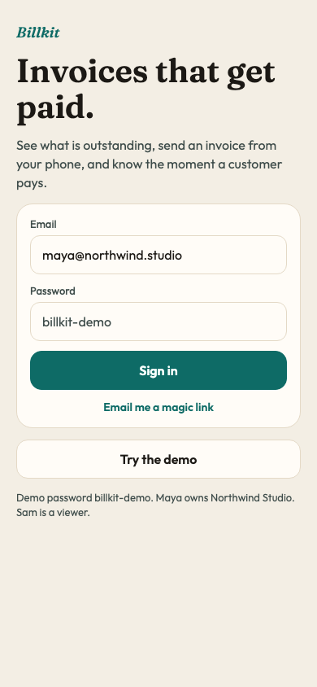 | 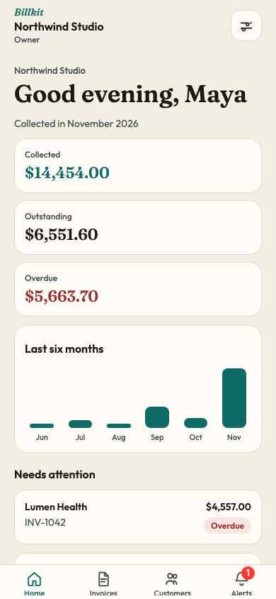 |

| Invoices | Invoice |
| --- | --- |
| 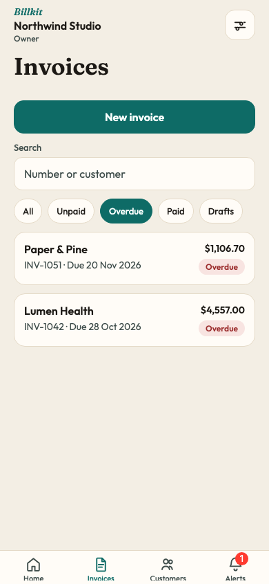 | 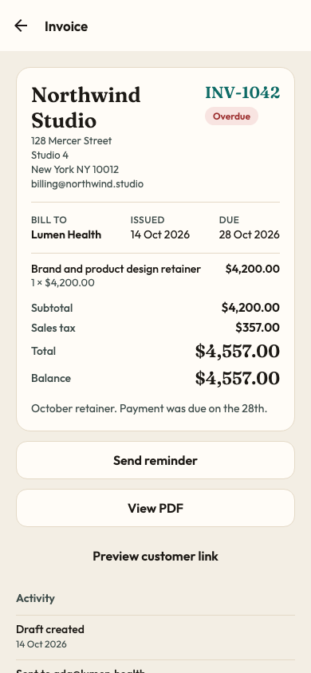 |

| New invoice | PDF |
| --- | --- |
| 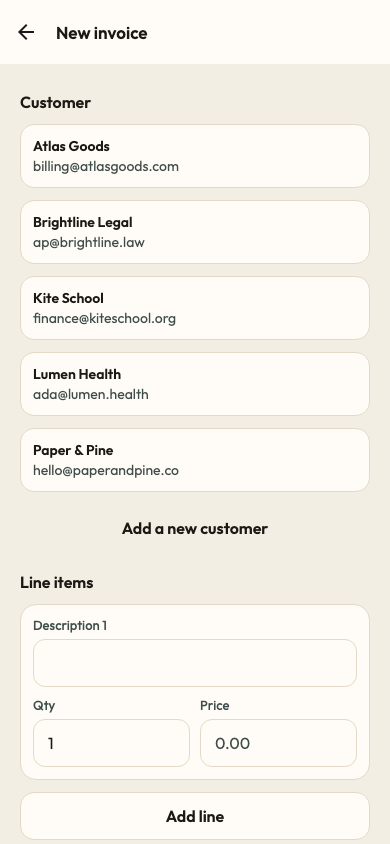 | 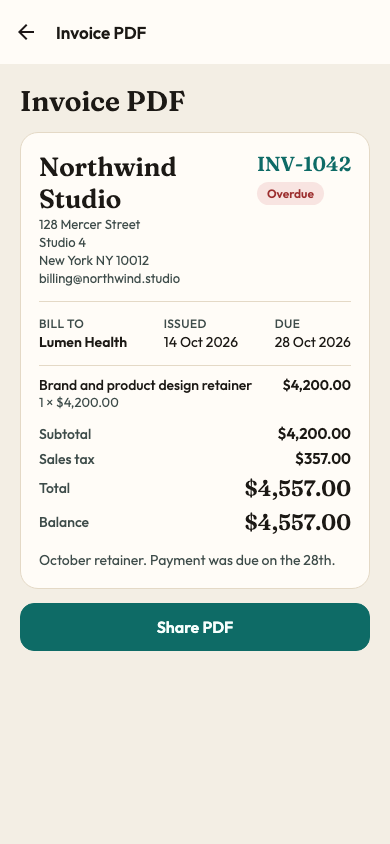 |

| Customer pay link | Paid |
| --- | --- |
| 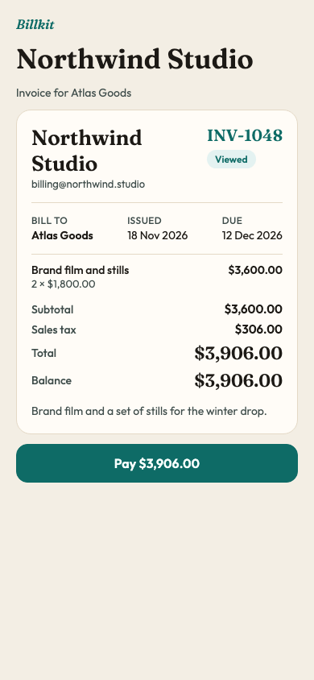 | 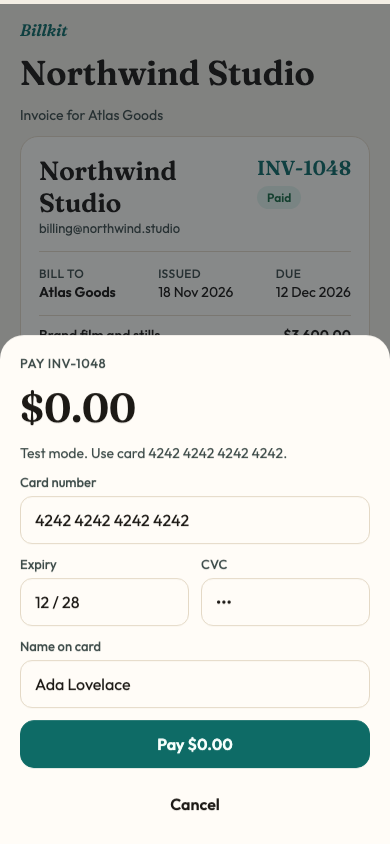 |

| Payment sheet | Alerts | Dark settings |
| --- | --- | --- |
| 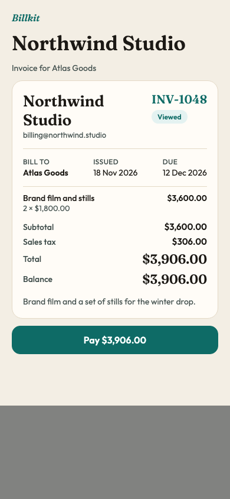 | 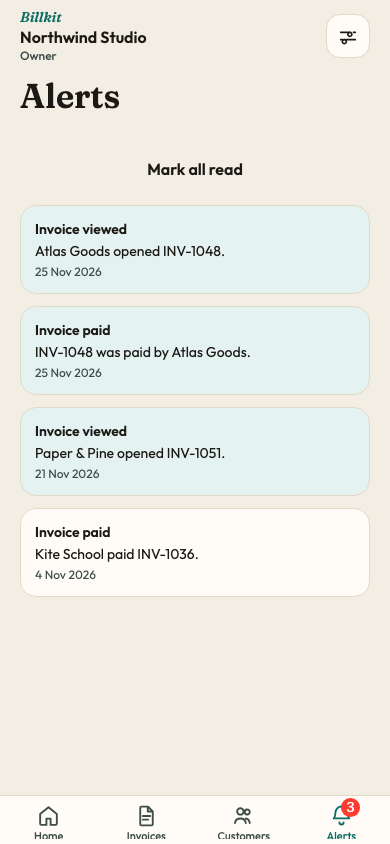 | 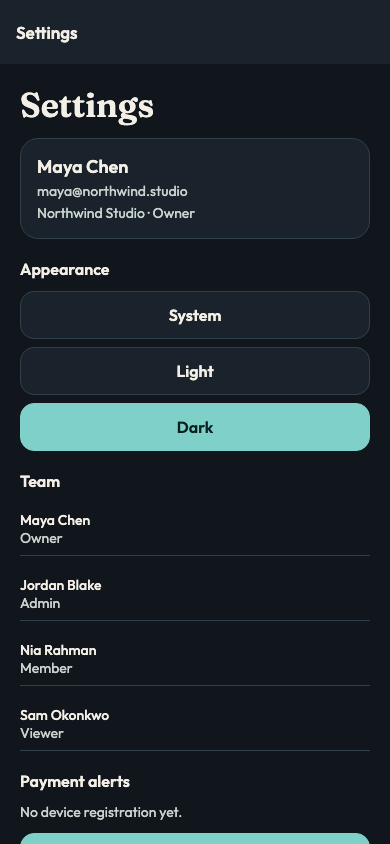 |

## Architecture

```
src/app            Expo Router screens
src/screens        Screen components
src/components     Design system and invoice paper
src/domain         Money, tax, status, permissions, dashboard math
src/data           Repository interface, seeded mock store, Supabase client
src/notifications  Local alerts (native) and in-app alerts (web)
supabase/schema.sql
supabase/functions Shared invoice, Stripe Checkout, Stripe webhook
```

The UI depends on `BillkitRepository`. `createRepository()` uses Supabase only when both `EXPO_PUBLIC_SUPABASE_URL` and `EXPO_PUBLIC_SUPABASE_ANON_KEY` (or `EXPO_PUBLIC_SUPABASE_PUBLISHABLE_KEY`) are set. Otherwise it uses the in-memory demo, persisted with AsyncStorage.

Roles live on `organization_members`, not in user-editable JWT metadata. The client never contains a service-role key. Anonymous customers do not get table access. A shared invoice is loaded by the `shared-invoice` edge function, and Stripe Checkout is created by `create-invoice-checkout`. The webhook records the payment and notifies owners, admins, and accountants. Those functions are deployed with the companion backend. They are not bundled into the app.

Demo accounts, password `billkit-demo`:

| Email | Role |
| --- | --- |
| maya@northwind.studio | Owner at Northwind Studio, accountant at Harbor & Co |
| jordan@northwind.studio | Admin at Northwind Studio |
| nia@northwind.studio | Member, drafts only |
| sam@northwind.studio | Viewer |
| riley@harborandco.com | Owner at Harbor & Co |

The demo ledger is frozen on 25 Nov 2026 so overdue invoices and November totals stay stable.

## Mock mode and real mode

Mock mode is the default. No `.env` file is required. Settings shows “Demo data on this device”, can switch demo accounts, reset the ledger, and simulate offline.

Real mode:

```bash
cp .env.example .env
# EXPO_PUBLIC_SUPABASE_URL=https://<project>.supabase.co
# EXPO_PUBLIC_SUPABASE_ANON_KEY=<anon or publishable key>
```

Apply `supabase/schema.sql` on the companion project, deploy the three edge functions, and set `STRIPE_SECRET_KEY`, `STRIPE_WEBHOOK_SECRET`, and `SUPABASE_SERVICE_ROLE_KEY` on those functions only. Restart Expo after changing env vars so Metro inlines them.

## Run

```bash
npm install
npm run web
```

Web preview: [http://127.0.0.1:43117](http://127.0.0.1:43117)

Expo Go, from the project directory:

```bash
npm start
```

Scan the QR code. Push registration on Android needs a development build from SDK 53 onward. Local alerts and the in-app Alerts tab still work in Expo Go. The bundle id is `com.quvantic.billkit`.

Static web export, suitable for `billkit-app.quvantic.com`:

```bash
npm run export:web
node scripts/serve-web.mjs 4173
```

EAS profiles are in `eas.json` (`development`, `preview`, `production`). This repo does not run cloud builds.

```bash
npx eas-cli@latest build --profile preview --platform android
```

A preview build needs an Expo account. It is not required to try the demo.

## Tests

```bash
npm run lint
npm run typecheck
npm test
npm run export:web
npm run test:e2e
```

- Jest and React Native Testing Library cover money, tax, permissions, the dashboard, the mock repository (including persistence), and the sign-in screen.
- Maestro flows in `.maestro/` cover the owner reminder path and the customer pay link on a simulator.
- Playwright runs the same owner, create, pay, magic-link, and error flows against the web export. CI uses this so it does not need a simulator.

GitHub Actions (`.github/workflows/ci.yml`) runs lint, typecheck, unit tests, the web export, and Playwright on `ubuntu-latest` with no secrets.

## What a person still has to do

- Apple Developer and Google Play accounts before store submission.
- An Expo account and `eas init` before a cloud build. Remote Expo push also needs that project id.
- A Supabase project: run `supabase/schema.sql`, deploy the edge functions, and put the URL and anon or publishable key in `.env`.
- Stripe test-mode secret and webhook signing secret on the edge functions, not in the app.
- DNS for `billkit-app.quvantic.com` to the host that serves the web export, plus the Apple and Android associated-domain files on that host.
